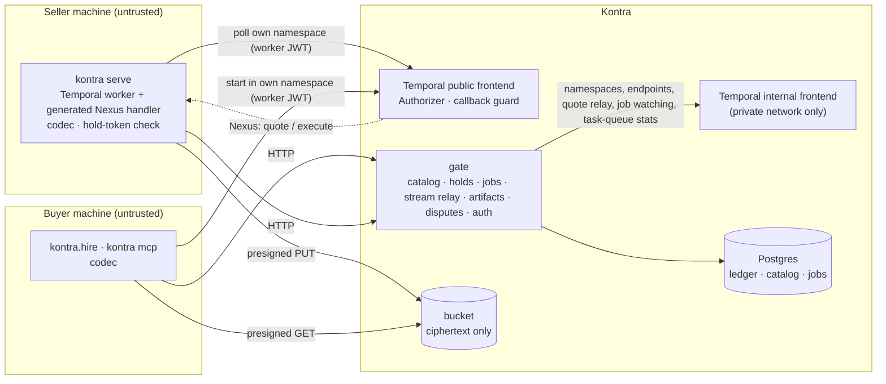

# Architecture

Kontra is a thin layer around Temporal: sellers run plain Temporal workers on their own
hardware, buyers reach them through Nexus, and Kontra adds identity, a catalog, escrow and the
Temporal frontend. This document describes how the code is cut so that the layer stays thin:
the deployables, the six seams, and the rules that keep each seam honest. The design is the
PRD (`kontra-cloud/PRD.md`); where implementing it required a choice, the choice is in
[decisions.md](decisions.md).

- [What runs where](#what-runs-where)
- [Two repositories, one direction](#two-repositories-one-direction)
- [The package](#the-package)
- [The six seams](#the-six-seams)
- [Names: constructed, never parsed](#names-constructed-never-parsed)
- [A job, end to end](#a-job-end-to-end)
- [One environment definition](#one-environment-definition)
- [CI and releases](#ci-and-releases)

## What runs where

Kontra operates two things: **the gate** (one Python process: FastAPI, with the ledger,
catalog and auth as modules, not services) and **the Temporal server image** built from
`temporal/authorizer` (every Temporal service in one process, with the Authorizer and the
callback guard compiled in). Postgres and an S3-compatible bucket are infrastructure. Kontra
never runs seller code.

## Two repositories, one direction

| Repository | Holds | Visibility |
|---|---|---|
| `kontra-sdk` (this one) | the `kontra` package, the Authorizer and Temporal image, the examples, `spec/`, `compose.yaml` | public |
| `kontra-cloud` | the gate, its migrations, the console, infrastructure | private |

**The dependency runs one way.** `kontra-cloud` imports this package (it calls
`kontra.contract`, so the contract hash is computed by the same code on both sides). This
package never imports the platform; it speaks HTTP to the gate through `kontra.gate_client`
and nothing else. Nothing Stripe-shaped, payout-shaped or PII-shaped belongs here. The console
is a gate client with no privileged path: if it needs something the CLI cannot do, the gate
API is wrong.

Inside the gate, modules talk through typed functions, never through each other's tables, which
is what lets a ledger adapter be swapped and keeps a future split into services mechanical.

## The package

| Module | Does |
|---|---|
| `kontra.contract` | the contract document: derivation from types, merge of a hand-written Nexus document, RFC 8785 canonical JSON, the hash, validation, the A2A card, `names` |
| `kontra.codec` | the `PayloadCodec`: age encryption with recipients from the serialization context, claim-check above 256 KiB; a job stream's poll answers sealed item by item (`kontra.codec.stream`, decisions I31) |
| `kontra.artifacts`, `kontra.types` | `Artifact`: streamed, encrypted upload and verified download through presigned URLs |
| `kontra.gate_client` | the hand-written HTTP client: one method per route of `routes.py`, models in `models.py` |
| `kontra.profile`, `kontra.auth` | the local profile, this machine's key and a buyer's per-job keys; the session that refreshes gate and Temporal tokens |
| `kontra._jobkeys`, `kontra._devices` | share to my account (decisions I25): a job key wrapped to each of the account's devices with a proof of possession (shared with the gate), and this machine as one of them |
| `kontra` | only what Kontra defines (decisions I29): `serve`, `Worker` and `KontraPlugin`, loaded on first use, and `__version__`; no Temporal re-exports (seller code imports `temporalio` itself) |
| `kontra.plugin` | `KontraPlugin`, a `temporalio` client and worker plugin: everything Kontra adds to a seller's Temporal -- the connection from the profile, the namespace, the codec, the task queue from the contract, the generated Nexus service, the interceptor (which hosts, marks, guards and drains each job's workflow stream), the sandbox passthrough, and at start the JWKS, the hash lock (contract and `streams`) and the progress forwarder |
| `kontra.serve` | the seller's `serve()` and `Worker` (the process runner, built on `KontraPlugin`): binding a workflow class or an agent's handler, activity discovery by a scan of the project, the generated Nexus handler, the hold-token check, progress published on the job's stream, the bound handler's turn wrapper (`kontra.serve.turn`, which mirrors the listed topics); Temporal's own metrics and spans, and the worker's logs, when asked (`kontra serve --metrics`, `--otlp`) |
| `kontra.contrib.parallel` | an optional helper, not core: `execute_activities_in_parallel` and its `kontra.batch.v1` child, registered by `ParallelPlugin` only when a seller passes it |
| `kontra.hire` | the buyer's `Kontra` client, `service()` for workflows, the hire worker |
| `kontra.mcp` | `kontra mcp`, the eight agent tools and a seller's `workers`, built on `kontra.hire` |
| `kontra.cli` | the `kontra` command; no business rule lives here |
| `kontra.ledger`, `kontra.escrow` | the `Ledger` Protocol; the job and escrow rules as pure functions, engine-neutral (a job's lineage is an opaque `pin`) |
| `kontra.engine` | seam ⑥ (decisions I32): the gate↔engine Protocol and its types -- an opaque job handle, a pin, sealed-only content (`Sealed`, `SealedPayload`), `STOPS` mapping escrow's effects; imports no `temporalio`. `kontra.engine.temporal`: `TemporalEngine`, the only adapter, over `kontra._control` and `kontra._relay`, with the Workers view as its Temporal-only extension |
| `kontra.workers` | the Workers view's verdict, as pure functions of what `DescribeTaskQueue` reports |
| `kontra.graph` | a run's history read back as a graph (decisions I26): nodes, causal edges and status, the union of mock runs and a live run painted on it, Temporal UI and Grafana links, Mermaid; no payload without a codec, and the standard library only at import |
| `kontra._relay` | the gate's stream relay (decisions I31): a job's workflow stream read with the poll Update and the offset Query only, on a relay token; the fake gate and the platform gate both use it, and it imports no `temporalio.contrib` |
| `kontra._control` | the Temporal adapter's calls on the internal frontend (the Workers view's `DescribeTaskQueue` and `ListWorkers` among them), shared by the real and the fake gate |
| `kontra.testing` | a fake for every seam: `fake_ledger`, `fake_gate`, `fake_engine` (`FakeEngine`), a dev server with standalone Nexus, `Marketplace`; and the contracts every adapter passes: `ledger_contract`, `engine_contract` |

## The six seams

A seam is a boundary where one side cannot know the other's code, only its contract. Each has
one contract and one test in CI, and **a change that crosses a seam updates that seam's test in
the same pull request.**

| # | Seam | What crosses | Contract | Test | CI job |
|---|---|---|---|---|---|
| ① | Temporal frontend | Nexus calls, task polls, the hold-token header, `DescribeTaskQueue` in the token's own namespace (a seller's backlog), a party's updates, queries and signals to its own workflows, the stream relay's poll Update and offset Query on one job, the worker controller's deployment calls in `kontra-system` | Temporal's protocol + the policy in `temporal/authorizer` | the Go deny matrix + `tests/temporal` over the wire | `deny-matrix` (required) |
| ② | Gate HTTP API | quote, hire (with the job's own key), jobs, a job's stream (SSE), artifacts, disputes, catalog, publish, a party's recipients and devices, job-key wraps, the Workers view | `kontra/gate_client/models.py` + `routes.py` | `tests/gate_client/test_routes.py`; the gate's OpenAPI snapshot in `kontra-cloud` | `seams` |
| ③ | Contract document | the offering, seller to buyer: its types and facts (spec v2: `uses_hosted_model` when true, and no key) | `kontra/contract` + `spec/` | `tests/contract`; the golden `examples/*/contract.yaml`, reproduced byte for byte | `seams` |
| ④ | Ledger | money state | the `Ledger` Protocol (`kontra/ledger.py`) | `kontra.testing.ledger_contract` (the §9.3 invariants, 10,000 random interleavings) against every adapter | `seams` |
| ⑤ | Codec | plaintext to ciphertext | `kontra/codec` | round trips, plus scans of Temporal history, the bucket, a worker's metrics and exported spans (`tests/codec/test_codec_telemetry.py`) and the dev graph page's routes (`tests/codec/test_codec_console.py`) for a known plaintext marker | `seams` |
| ⑥ | Engine | gate to engine (decisions I32): a party's isolated home and credential; an offering's route; the quote call; a job's handle, start, observation (status, provenance, pin, sealed result), liveness, stops, fence, and the stream relay | the `Engine` Protocol (`kontra/engine/__init__.py`) | `kontra.testing.engine_contract` and its teeth (`tests/engine/broken_engines.py`) against `FakeEngine` and against `TemporalEngine` on a dev server (`tests/engine`); isolation and the relay credential over the wire (`tests/temporal/test_engine_isolation_wire.py`) | `seams` (+ `deny-matrix` for the wire half) |

Seam ⑥ is between the gate and an engine, and only there. Between a seller and its engine
there is no abstraction: seller code is native `temporalio` (decisions I29), and the façade
that once sat there is never rebuilt. The engine is a property of an offering version, fixed
at publish (`PublishRequest.engine`, beside the contract hash, never shown to a buyer), and
the gate dispatches every job op to that version's adapter. `kontra.engine.temporal` is the
only adapter (Nexus, namespaces and task queues are its implementation detail); the Protocol
was designed against Golem too, so no Temporal concept is in its types, and it never grows a
workflow-authoring member (`MEMBERS` is pinned by a test).

Every seam has a fake in `kontra.testing`, so each side can be built and tested without the
other: a seller runs a full lifecycle, timeout and refund included, in a unit test with no
containers; work on the gate never needs Temporal; work on `kontra.serve` never needs the gate.

Rules that keep the seams real:

- **One implementation per rule.** `kontra.contract` is the only code that derives,
  canonicalises, hashes or validates a contract; `publish`, `serve` and the gate all call it.
  `kontra/escrow.py` is the only statement of who gets paid when; the real and the fake gate
  both run it. `kontra/workers.py` is the only code that turns a task queue's numbers into a
  verdict; the real and the fake gate both run it too. `kontra.engine.temporal`, over
  `kontra._control`, is the only way a gate reaches Temporal (seam ⑥); `kontra._control` is the
  only code that talks to the internal frontend.
- **Sellers write native Temporal** (decisions I29, superseding D1/I20). Seller
  `workflows.py` and `activities.py` import `temporalio` directly and nothing from `kontra`, so
  without `worker.py` they run on any Temporal worker (all but `Artifact` I/O, which needs the
  Kontra runtime `worker.py`'s plugin installs); `worker.py` is the one file that imports
  `kontra` (`quote.py` takes `kontra.serve.Quote`, `models.py` may use `kontra.types.Artifact`).
  The tests check the examples and the `kontra init` scaffold, and run `examples/hello` without
  `worker.py` on a plain Temporal worker. What constrains a seller is not what they import: the
  Authorizer, the codec, the contract hash, `names.py` and escrow. `kontra publish` scans
  nothing; continue-as-new is the seller's.
- **Kontra last.** A seller's client plugins go on the client before `KontraPlugin`, which has
  the last word on the connection, the namespace and the codec; the codec is a payload codec,
  so it stacks under whatever payload converter an earlier plugin set. Kontra never imports
  `temporal_agent_harness`: `kontra/serve/turn.py` holds its wire shape as constants.
- **A tested temporalio range.** `temporalio>=1.34,<1.38`, one constant pair in
  `kontra._compat`: a Kontra worker refuses to start outside it, `kontra serve` and
  `kontra publish` warn.
- **Distribution name.** The PyPI distribution is `kontra-sdk`; a bare `kontra` dependency
  installs an unrelated project.

## Names: constructed, never parsed

An identifier that is encoded and later parsed back is a classic source of confusion bugs:
two strings that decode alike, a prefix check a crafted name satisfies, a pattern that accepts
a trailing newline. So every Temporal identifier is built in one place,
`kontra/contract/names.py`, and used as an opaque string everywhere else:

| Identifier | Example | Made by |
|---|---|---|
| Nexus endpoint | `k3f9c...` (`k` + 32 random hex) | the catalog, at first publish; **means nothing** |
| Nexus service (wire) | `acme.enrich` | constructed (a `/` breaks Temporal's Nexus HTTP routing) |
| nexgen service key | `AcmeEnrich`, with `fqn: acme.enrich` | constructed |
| Task queue | `acme/enrich@1.2.0` | constructed |
| Seller namespace | `acme` | a party's namespace is its handle |
| Platform namespace | `kontra-system` | a constant (`PLATFORM_NAMESPACE`), a reserved handle no party can take |
| Stream relay's Temporal subject | `relay/acme/job-<32 hex>` | constructed from the seller's namespace and the job id (`relay_subject`); the Authorizer rebuilds it from a request and compares it whole |
| Worker controller's Temporal subject | `platform/worker-controller` | a constant (`WORKER_CONTROLLER_SUBJECT`); like the relay's, it contains `/`, which no handle can |
| Handler workflow id | `job-<32 hex>` | constructed from the job id (for a bound agent handler, the job is Kontra's `kontra.turn.v1` wrapper) |
| Agent child workflow id | `job-<32 hex>/agent` | constructed from the job id, for the agent a bound handler's wrapper starts; not job-shaped, so the codec encrypts its payloads to the seller alone |
| Batch child workflow id | `<parent workflow id>/batch/<activity>/<uuid4>` (`job-<32 hex>/batch/...` under a handler) | constructed from the parent's id, the activity's Temporal name and a `workflow.uuid4()` of the parent's, for the `kontra.batch.v1` child; reads back as no job id |

- No code splits a task queue, service name or endpoint to recover an offering, and no
  authorization decision reads one. The Authorizer decides by exact equality and set
  membership on the token's claims and the request's namespace, and for the gate's stream
  relay alone on the request's workflow id and handler name, compared whole with values it
  constructs (decisions I30).
- The catalog is the only map between an endpoint and an offering, in both directions
  (`CatalogEntry.endpoint`, `GET /v1/endpoints/{endpoint}`). A contract document does not
  contain its endpoint: the endpoint is assigned after the document is sealed. Nor does it
  contain a key (spec v2): a party's recipients are catalog data too
  (`CatalogEntry.recipients`), so adding or revoking one never forces a republish.
- What people type (`acme/enrich@1.2`, a version, a handle) is validated with anchored,
  ASCII-only `fullmatch` patterns and length limits, never stripped or normalised first.
- The one inverse that exists, workflow id to job id, is construct-and-compare: a candidate is
  accepted only if rebuilding the workflow id from it reproduces the input exactly.
- A job's engine handle (seam ⑥, decisions I32) is opaque bytes the adapter minted at hire and
  the gate stores verbatim. Only that adapter reads it -- strictly, before any I/O: its prefix and
  size, exactly its keys, each field by its own anchored validator, and the bytes rebuilt from
  the fields must be the input -- and then *constructs* the namespaces, workflow id and service
  from those fields with `names.py`. It is never shown to a party and never authorizes anything:
  provenance is the engine's records against the gate's own holds.

## A job, end to end

1. **Quote.** The buyer's client validates the input against the contract and encrypts it to
   every recipient the seller holds, as the catalog lists them. The gate relays it, byte for
   byte, as a synchronous Nexus call on the internal frontend's HTTP API to the seller's
   handler, which runs `quote`. The answer comes back in plaintext (the gate must read the
   price) and the gate records it as a quote with an expiry.
2. **Hire.** The buyer's client makes the job's own age key and sends its public half with
   the hire; the gate locks the price in the ledger against a new job id, binds the job to the
   version's engine (an opaque handle, seam ⑥) and signs a hold token that names that key
   (`buyer_key`), never one of the buyer party's. The buyer's
   client starts `execute` as a standalone Nexus operation **in the buyer's own namespace**,
   with the token in the `kontra-hold` header and the job's `max_duration` as its
   schedule-to-close timeout. (A buyer workflow is itself the Nexus caller; clients without
   Temporal ask the gate to start it for them.)
3. **Start.** Temporal dispatches the operation to the seller's worker. The handler verifies
   the token offline, validates the input, re-runs `quote`, and starts the seller's workflow as
   `job-<id>` with reject-duplicate, so one hold starts at most one execution.
4. **Work.** The workflow runs as any Temporal workflow does. What it publishes on its
   workflow stream, and its activities' heartbeats (on the `kontra.progress` topic), stay in
   the job's history, encrypted; while the buyer listens, the gate relays the topics the
   offering lists with a relay token (the poll Update and the offset Query, nothing else),
   each item sealed to the job's parties on its own, and merges them with liveness it reads
   from history metadata into the job's stream (`GET /v1/jobs/{id}/stream`, decisions I31).
5. **Delivery.** The result is encrypted to the job's key (and every recipient of the
   seller's) and travels back through Nexus; the gate, observing the job through its engine's
   adapter (`job-<id>` through the internal frontend), records the delivery and its hash and
   opens the review window. The adapter hands the gate only the codec's sealed envelope: a
   completion that is not one is no delivery, refunded against the seller (decisions I32).
6. **Settlement.** Accept, or silence until the window closes, releases the hold to the seller
   minus the platform fee; reject opens a dispute. A failure, a missed deadline or a cancel
   refunds. A cancel of a job whose run the gate has seen terminates that run first and
   refunds only once Temporal shows it terminated: a run that completed first has already
   delivered to the buyer's call, so it is a delivery and the cancel is refused. Timers live in Postgres and a sweep loop, not in Temporal; every sweep re-issues the
   ledger calls the job's record says are owed (they are idempotent) until ledger and record
   agree.

The gate never starts the seller's workflow and never reads a payload: everything it decides
from is a workflow state, a timestamp or a buyer's call.

## One environment definition

`compose.yaml` at the root is the stack: Postgres, the bucket, Kontra's Temporal server and the
gate. `kontra dev` runs it on a laptop (it ships in the wheel as `kontra/_dev/compose.yaml`),
CI's e2e job runs it, and v1 production runs it, with different env files. It carries no
default secret; `kontra dev` writes random credentials and `KONTRA_DEV=1` (dev login, play
money) into `$KONTRA_HOME/dev.env`, and `kontra dev up` adds the host ports it ran with
(`KONTRA_DEV_*_PORT`), so `status`, `logs` and `down` find the stack where `up` put it. It never
remembers a bind address (`KONTRA_DEV_BIND`, `KONTRA_DEV_PG_BIND`): publishing a dev gate (dev
login, play money) beyond loopback is asked for on each `up`, not inherited from an earlier one.

Temporal's internal frontend has no authentication: reaching it is control of every
namespace. It is never published, and it listens on one address only: Temporal's fixed
address on `control`, the network it shares with the gate alone. That network's subnet is
pinned so the address is known before Temporal starts (Temporal binds the internal frontend
there and dials its own system worker, Nexus dispatch and completions there too):
`KONTRA_CONTROL_NET` gives its first three octets (default `172.16.251`, outside Docker's
default address pools); the stack takes `.0/28` of it, Temporal is `.2`, and every other
address comes from `.8/29`, so no container can take Temporal's. Temporal still joins only
networks whose other members may reach its other ports:

| Network | Members | Carries |
|---|---|---|
| `control` | temporal (`.2`), gate | the internal frontend (gRPC 7236, HTTP 7246); the gate's JWKS |
| `temporal-db` | temporal, postgres-relay | Temporal's own database connections (the internal frontend does not listen here; a peer that could route Temporal's `control` address through it would still reach it, which takes a capability the relay does not have) |
| `database` | postgres, postgres-relay, gate, migrate | the gate's and the migrations' database connections |
| `bucket` | s3, gate | SeaweedFS's S3 port and its unauthenticated master, volume and filer ports |
| `observability` | prometheus, grafana (the `observability` profile) | Grafana's queries to Prometheus |
| `telemetry` | otelcol, loki, tempo, grafana (the `observability` profile) | the collector's writes to Loki and Tempo; Grafana's queries to them |

Two compose profiles add dev tools that production never enables (`kontra dev up --ui`,
`--observability`; [sellers.md](sellers.md#the-ui-and-the-dashboards)). The `ui` profile puts
Temporal's UI on `control`: it reads every namespace through the internal frontend, which is
the point of it locally and why it is published on 127.0.0.1 only. The `observability`
profile puts Prometheus on `temporal-db`, to scrape the metrics listener Temporal opens there
when asked (`KONTRA_TEMPORAL_METRICS_ADDR`), held to the relay's terms there (no
capabilities, not root, no forwarding), and Grafana on `observability` and `telemetry`, with
forwarding off. The OpenTelemetry Collector (`otelcol`), which takes whatever reaches its
port published on 127.0.0.1 (what `kontra serve --otlp` exports), shares `telemetry` with
the two stores it writes, Loki and Tempo, and with Grafana, and no network with Prometheus or
Temporal. Prometheus's agent (`prometheus-agent`) is on no network of the stack's: it runs in
the host's network namespace, because a worker's `kontra serve --metrics 127.0.0.1:PORT` is
on the host's loopback and a container on a bridge network reaches the host only through
Docker's gateway, which a host firewall may drop (ufw's default does, measured). It scrapes
those ports and writes the samples to Prometheus's published port; it keeps no database,
answers no query, and has no capabilities, a read-only root and an unprivileged user. Like
any process of the host's it can reach the stack's networks, the internal frontend among
them: it is a dev tool, on a machine that is yours.

`postgres-relay` is busybox `nc` from the pinned Postgres image itself: it accepts Temporal's
connections and opens one to Postgres for each, copying bytes, and never connects to Temporal
(no capabilities, read-only, not root). So Postgres -- large third-party code a SQL injection
in the gate would reach -- the migrate job and SeaweedFS share no network with Temporal, and
Docker drops traffic between bridge networks: none of them can reach the internal frontend.
A container inherits the host's `net.ipv4.ip_forward=1`, which makes a service on two networks
a router between them (packets from `database` routed through the relay arrive at Temporal's
`temporal-db` address; only Docker dropping the reply stops the handshake), so every
multi-homed service -- the relay, Temporal and the gate -- sets it to 0. This rests on Docker's
own inter-network isolation (its iptables rules): a host that runs Docker with `iptables:
false` routes between bridge networks and has no such boundary.
Temporal's proxy variables are set empty: compose copies a Docker client's proxy settings into
every container, and Go exempts only loopback from a proxy, so Temporal's connections to its own
internal frontend (at its `control` address) would otherwise go to the proxy, and it would not
start. SeaweedFS's are empty for the same reason (its master, volume server, filer and S3
gateway dial one another over gRPC at the container's address). The healthchecks turn proxies
off themselves (busybox `wget -Y off`, an empty urllib `ProxyHandler`), so the gate's own
environment, whose internet egress honours an operator's proxy, stays as given.

Every service runs with no capabilities (`cap_drop: [ALL]`, none added back), with
`no-new-privileges` and on a read-only root filesystem: code that takes one over cannot open
raw sockets, change file ownership, gain privileges through a setuid binary or replace the
service's own binaries, and it writes only to the service's volume or to a tmpfs that a
restart empties and that is capped in size (1 MiB each), so it cannot fill the host's memory
either. No long-running service runs as root. Postgres runs as its own user: its entrypoint
needs root only to chown a data directory the named volume already gives it. The SeaweedFS
image has no user but root, and its `/data` -- so the named volume, which Docker fills from it
-- is root's: `s3-owner`, a one-shot with no network, hands the volume to uid 10001 and exits,
and SeaweedFS runs as that uid. It is the only container given capabilities, `CHOWN` and
`DAC_READ_SEARCH` (SeaweedFS creates its directories 0700, which `CHOWN` alone cannot walk on
a later start), for one fixed `chown -R`. SeaweedFS is handed its
credentials in its environment and writes them to its tmpfs before it starts: compose's
`configs` copy their content into the container's root filesystem, which a read-only root
refuses.
Third-party images are pinned by digest with their tag beside it (Postgres and SeaweedFS in
`compose.yaml`; the Go builder and the runtime bases in `temporal/authorizer`'s Dockerfiles),
and the Temporal server is built with the Go toolchain `go.mod` names.

## CI and releases

| Workflow | When | What |
|---|---|---|
| `ci.yml` | every pull request; pushes to `dev` | `lint`, `typecheck`, `test` and `seams` (each on Python 3.11 and 3.12), `deny-matrix` (each one `make` target; `make check` is their union), then `e2e` against `kontra dev` when the gate image is readable (not a fork's pull request while that image is private: decisions I14) |
| `security.yml` | every push and pull request; weekly | gitleaks, pip-audit, Trivy on the built Temporal image, an SBOM, zizmor |
| `temporal-image.yml` | a change under `temporal/authorizer/` (which pins the Temporal server version in `go.mod`) | build; on `dev`, push `ghcr.io/medmahmoudi26/kontra-temporal` tagged by commit SHA and `:dev` |
| `release.yml` | a tag `v*` on `dev` or `main` | build the sdist and wheel, publish `kontra-sdk` to PyPI by trusted publishing (OIDC), attach the SBOM to the GitHub release |

Branches: work on a topic branch and open the pull request against `dev`; `main` moves only by
merging `dev`, deliberately. See [CONTRIBUTING.md](../CONTRIBUTING.md).
