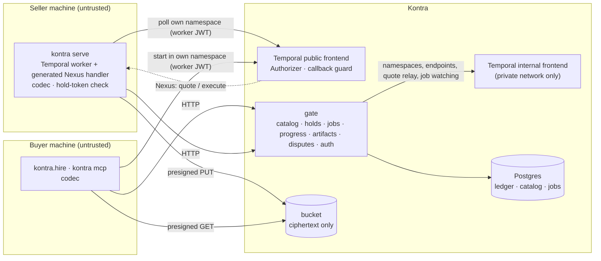

# Architecture

Kontra is a thin layer around Temporal: sellers run plain Temporal workers on their own
hardware, buyers reach them through Nexus, and Kontra adds identity, a catalog, escrow and the
Temporal frontend. This document describes how the code is cut so that the layer stays thin:
the deployables, the five seams, and the rules that keep each seam honest. The design is the
PRD (`kontra-cloud/PRD.md`); where implementing it required a choice, the choice is in
[decisions.md](decisions.md).

- [What runs where](#what-runs-where)
- [Two repositories, one direction](#two-repositories-one-direction)
- [The package](#the-package)
- [The five seams](#the-five-seams)
- [Names: constructed, never parsed](#names-constructed-never-parsed)
- [A job, end to end](#a-job-end-to-end)
- [One environment definition](#one-environment-definition)
- [CI and releases](#ci-and-releases)

## What runs where

Kontra operates two things: **the gate** (one Python process: FastAPI, with the ledger,
catalog and auth as modules, not services) and **the Temporal server image** built from
`temporal/authorizer` (every Temporal service in one process, with the Authorizer and the
callback guard compiled in). Postgres and an S3-compatible bucket are infrastructure. Kontra
never runs seller code.

## Two repositories, one direction

| Repository | Holds | Visibility |
|---|---|---|
| `kontra-sdk` (this one) | the `kontra` package, the Authorizer and Temporal image, the examples, `spec/`, `compose.yaml` | public |
| `kontra-cloud` | the gate, its migrations, the console, infrastructure | private |

**The dependency runs one way.** `kontra-cloud` imports this package (it calls
`kontra.contract`, so the contract hash is computed by the same code on both sides). This
package never imports the platform; it speaks HTTP to the gate through `kontra.gate_client`
and nothing else. Nothing Stripe-shaped, payout-shaped or PII-shaped belongs here. The console
is a gate client with no privileged path: if it needs something the CLI cannot do, the gate
API is wrong.

Inside the gate, modules talk through typed functions, never through each other's tables, which
is what lets a ledger adapter be swapped and keeps a future split into services mechanical.

## The package

| Module | Does |
|---|---|
| `kontra.contract` | the contract document: derivation from types, merge of a hand-written Nexus document, RFC 8785 canonical JSON, the hash, validation, the A2A card, `names` |
| `kontra.codec` | the `PayloadCodec`: age encryption with recipients from the serialization context, claim-check above 256 KiB |
| `kontra.artifacts`, `kontra.types` | `Artifact`: streamed, encrypted upload and verified download through presigned URLs |
| `kontra.gate_client` | the hand-written HTTP client: one method per route of `routes.py`, models in `models.py` |
| `kontra.profile`, `kontra.auth` | the local profile and key; the session that refreshes gate and Temporal tokens |
| `kontra.serve` | the seller's `Worker`: generated Nexus handler, hold-token check, codec, progress forwarding |
| `kontra.hire` | the buyer's `Kontra` client, `service()` for workflows, the hire worker |
| `kontra.mcp` | `kontra mcp`, the eight agent tools, built on `kontra.hire` |
| `kontra.cli` | the `kontra` command; no business rule lives here |
| `kontra.ledger`, `kontra.escrow` | the `Ledger` Protocol; the job and escrow rules as pure functions |
| `kontra._control` | the control-plane calls on Temporal's internal frontend, shared by the real and the fake gate |
| `kontra.testing` | a fake for every seam: `fake_ledger`, `fake_gate`, a dev server with standalone Nexus, `Marketplace` |

## The five seams

A seam is a boundary where one side cannot know the other's code, only its contract. Each has
one contract and one test in CI, and **a change that crosses a seam updates that seam's test in
the same pull request.**

| # | Seam | What crosses | Contract | Test | CI job |
|---|---|---|---|---|---|
| ① | Temporal frontend | Nexus calls, task polls, the hold-token header | Temporal's protocol + the policy in `temporal/authorizer` | the Go deny matrix + `tests/temporal` over the wire | `deny-matrix` (required) |
| ② | Gate HTTP API | quote, hire, jobs, progress, artifacts, disputes, catalog, publish | `kontra/gate_client/models.py` + `routes.py` | `tests/gate_client/test_routes.py`; the gate's OpenAPI snapshot in `kontra-cloud` | `seams` |
| ③ | Contract document | the offering, seller to buyer | `kontra/contract` + `spec/` | `tests/contract`; the golden `examples/*/contract.yaml`, reproduced byte for byte | `seams` |
| ④ | Ledger | money state | the `Ledger` Protocol (`kontra/ledger.py`) | `kontra.testing.ledger_contract` (the §9.3 invariants, 10,000 random interleavings) against every adapter | `seams` |
| ⑤ | Codec | plaintext to ciphertext | `kontra/codec` | round trips, plus scans of Temporal history and the bucket for a known plaintext marker | `seams` |

Every seam has a fake in `kontra.testing`, so each side can be built and tested without the
other: a seller runs a full lifecycle, timeout and refund included, in a unit test with no
containers; work on the gate never needs Temporal; work on `kontra.serve` never needs the gate.

Rules that keep the seams real:

- **One implementation per rule.** `kontra.contract` is the only code that derives,
  canonicalises, hashes or validates a contract; `publish`, `serve` and the gate all call it.
  `kontra/escrow.py` is the only statement of who gets paid when; the real and the fake gate
  both run it. `kontra._control` is the only code that talks to the internal frontend.
- **D1.** Seller `workflows.py` and `activities.py` import nothing from `kontra`; `models.py`
  may use `kontra.types.Artifact`. The tests check the examples.
- **Distribution name.** The PyPI distribution is `kontra-sdk`; a bare `kontra` dependency
  installs an unrelated project.

## Names: constructed, never parsed

An identifier that is encoded and later parsed back is a classic source of confusion bugs:
two strings that decode alike, a prefix check a crafted name satisfies, a pattern that accepts
a trailing newline. So every Temporal identifier is built in one place,
`kontra/contract/names.py`, and used as an opaque string everywhere else:

| Identifier | Example | Made by |
|---|---|---|
| Nexus endpoint | `k3f9c...` (`k` + 32 random hex) | the catalog, at first publish; **means nothing** |
| Nexus service (wire) | `acme.enrich` | constructed (a `/` breaks Temporal's Nexus HTTP routing) |
| nexgen service key | `AcmeEnrich`, with `fqn: acme.enrich` | constructed |
| Task queue | `acme/enrich@1.2.0` | constructed |
| Seller namespace | `acme` | a party's namespace is its handle |
| Handler workflow id | `job-<32 hex>` | constructed from the job id |

- No code splits a task queue, service name or endpoint to recover an offering, and no
  authorization decision reads one. The Authorizer decides by exact equality and set
  membership on the token's claims and the request's namespace.
- The catalog is the only map between an endpoint and an offering, in both directions
  (`CatalogEntry.endpoint`, `GET /v1/endpoints/{endpoint}`). A contract document does not
  contain its endpoint: the endpoint is assigned after the document is sealed.
- What people type (`acme/enrich@1.2`, a version, a handle) is validated with anchored,
  ASCII-only `fullmatch` patterns and length limits, never stripped or normalised first.
- The one inverse that exists, workflow id to job id, is construct-and-compare: a candidate is
  accepted only if rebuilding the workflow id from it reproduces the input exactly.

## A job, end to end

1. **Quote.** The buyer's client validates the input against the contract and encrypts it.
   The gate relays it, byte for byte, as a synchronous Nexus call on the internal frontend's
   HTTP API to the seller's handler, which runs `quote`. The answer comes back in plaintext
   (the gate must read the price) and the gate records it as a quote with an expiry.
2. **Hire.** The gate locks the price in the ledger against a new job id and signs a hold
   token. The buyer's client starts `execute` as a standalone Nexus operation **in the buyer's
   own namespace**, with the token in the `kontra-hold` header and the job's `max_duration` as
   its schedule-to-close timeout. (A buyer workflow is itself the Nexus caller; clients without
   Temporal ask the gate to start it for them.)
3. **Start.** Temporal dispatches the operation to the seller's worker. The handler verifies
   the token offline, validates the input, re-runs `quote`, and starts the seller's workflow as
   `job-<id>` with reject-duplicate, so one hold starts at most one execution.
4. **Work.** The workflow runs as any Temporal workflow does. Heartbeat details are encrypted
   to the buyer and posted to the gate; the gate merges them with liveness it reads from
   history metadata into the job's progress stream.
5. **Delivery.** The result is encrypted to the buyer (and the seller) and travels back through
   Nexus; the gate, watching `job-<id>` through the internal frontend, records the delivery and
   its hash and opens the review window.
6. **Settlement.** Accept, or silence until the window closes, releases the hold to the seller
   minus the platform fee; reject opens a dispute. A failure, a missed deadline or a cancel
   refunds. A cancel of a job whose run the gate has seen terminates that run first and
   refunds only once Temporal shows it terminated: a run that completed first has already
   delivered to the buyer's call, so it is a delivery and the cancel is refused. Timers live in Postgres and a sweep loop, not in Temporal; every sweep re-issues the
   ledger calls the job's record says are owed (they are idempotent) until ledger and record
   agree.

The gate never starts the seller's workflow and never reads a payload: everything it decides
from is a workflow state, a timestamp or a buyer's call.

## One environment definition

`compose.yaml` at the root is the stack: Postgres, the bucket, Kontra's Temporal server and the
gate. `kontra dev` runs it on a laptop (it ships in the wheel as `kontra/_dev/compose.yaml`),
CI's e2e job runs it, and v1 production runs it, with different env files. It carries no
default secret; `kontra dev` writes random credentials and `KONTRA_DEV=1` (dev login, play
money) into `$KONTRA_HOME/dev.env`, and `kontra dev up` adds the host ports it ran with
(`KONTRA_DEV_*_PORT`), so `status`, `logs` and `down` find the stack where `up` put it. It never
remembers a bind address (`KONTRA_DEV_BIND`, `KONTRA_DEV_PG_BIND`): publishing a dev gate (dev
login, play money) beyond loopback is asked for on each `up`, not inherited from an earlier one.

Temporal's internal frontend has no authentication: reaching it is control of every
namespace. It is never published, and it listens on one address only: Temporal's fixed
address on `control`, the network it shares with the gate alone. That network's subnet is
pinned so the address is known before Temporal starts (Temporal binds the internal frontend
there and dials its own system worker, Nexus dispatch and completions there too):
`KONTRA_CONTROL_NET` gives its first three octets (default `172.16.251`, outside Docker's
default address pools); the stack takes `.0/28` of it, Temporal is `.2`, and every other
address comes from `.8/29`, so no container can take Temporal's. Temporal still joins only
networks whose other members may reach its other ports:

| Network | Members | Carries |
|---|---|---|
| `control` | temporal (`.2`), gate | the internal frontend (gRPC 7236, HTTP 7246); the gate's JWKS |
| `temporal-db` | temporal, postgres-relay | Temporal's own database connections (the internal frontend does not listen here; a peer that could route Temporal's `control` address through it would still reach it, which takes a capability the relay does not have) |
| `database` | postgres, postgres-relay, gate, migrate | the gate's and the migrations' database connections |
| `bucket` | s3, gate | SeaweedFS's S3 port and its unauthenticated master, volume and filer ports |

`postgres-relay` is busybox `nc` from the pinned Postgres image itself: it accepts Temporal's
connections and opens one to Postgres for each, copying bytes, and never connects to Temporal
(no capabilities, read-only, not root). So Postgres -- large third-party code a SQL injection
in the gate would reach -- the migrate job and SeaweedFS share no network with Temporal, and
Docker drops traffic between bridge networks: none of them can reach the internal frontend.
A container inherits the host's `net.ipv4.ip_forward=1`, which makes a service on two networks
a router between them (packets from `database` routed through the relay arrive at Temporal's
`temporal-db` address; only Docker dropping the reply stops the handshake), so every
multi-homed service -- the relay, Temporal and the gate -- sets it to 0. This rests on Docker's
own inter-network isolation (its iptables rules): a host that runs Docker with `iptables:
false` routes between bridge networks and has no such boundary.
Temporal's proxy variables are set empty: compose copies a Docker client's proxy settings into
every container, and Go exempts only loopback from a proxy, so Temporal's connections to its own
internal frontend (at its `control` address) would otherwise go to the proxy, and it would not
start. SeaweedFS's are empty for the same reason (its master, volume server, filer and S3
gateway dial one another over gRPC at the container's address). The healthchecks turn proxies
off themselves (busybox `wget -Y off`, an empty urllib `ProxyHandler`), so the gate's own
environment, whose internet egress honours an operator's proxy, stays as given.

Every service runs with no capabilities (`cap_drop: [ALL]`, none added back), with
`no-new-privileges` and on a read-only root filesystem: code that takes one over cannot open
raw sockets, change file ownership, gain privileges through a setuid binary or replace the
service's own binaries, and it writes only to the service's volume or to a tmpfs that a
restart empties and that is capped in size (1 MiB each), so it cannot fill the host's memory
either. No long-running service runs as root. Postgres runs as its own user: its entrypoint
needs root only to chown a data directory the named volume already gives it. The SeaweedFS
image has no user but root, and its `/data` -- so the named volume, which Docker fills from it
-- is root's: `s3-owner`, a one-shot with no network, hands the volume to uid 10001 and exits,
and SeaweedFS runs as that uid. It is the only container given capabilities, `CHOWN` and
`DAC_READ_SEARCH` (SeaweedFS creates its directories 0700, which `CHOWN` alone cannot walk on
a later start), for one fixed `chown -R`. SeaweedFS is handed its
credentials in its environment and writes them to its tmpfs before it starts: compose's
`configs` copy their content into the container's root filesystem, which a read-only root
refuses.
Third-party images are pinned by digest with their tag beside it (Postgres and SeaweedFS in
`compose.yaml`; the Go builder and the runtime bases in `temporal/authorizer`'s Dockerfiles),
and the Temporal server is built with the Go toolchain `go.mod` names.

## CI and releases

| Workflow | When | What |
|---|---|---|
| `ci.yml` | every pull request; pushes to `dev` | `lint`, `typecheck`, `test` and `seams` (each on Python 3.11 and 3.12), `deny-matrix` (each one `make` target; `make check` is their union), then `e2e` against `kontra dev` when the gate image is readable (not a fork's pull request while that image is private: decisions I14) |
| `security.yml` | every push and pull request; weekly | gitleaks, pip-audit, Trivy on the built Temporal image, an SBOM, zizmor |
| `temporal-image.yml` | a change under `temporal/authorizer/` (which pins the Temporal server version in `go.mod`) | build; on `dev`, push `ghcr.io/medmahmoudi26/kontra-temporal` tagged by commit SHA and `:dev` |
| `release.yml` | a tag `v*` on `dev` or `main` | build the sdist and wheel, publish `kontra-sdk` to PyPI by trusted publishing (OIDC), attach the SBOM to the GitHub release |

Branches: work on a topic branch and open the pull request against `dev`; `main` moves only by
merging `dev`, deliberately. See [CONTRIBUTING.md](../CONTRIBUTING.md).
