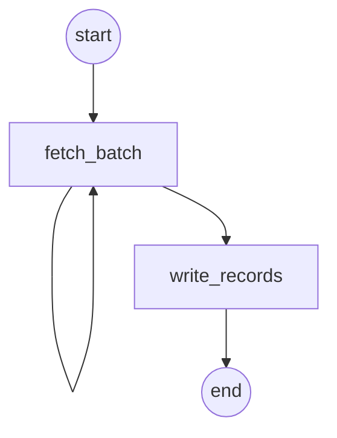

# enrich: the PRD's running example

A seller offering, `acme/enrich@1.2.0`: resolve a URL list to records (status, title, domain),
delivered as an encrypted JSONL `Artifact` plus a small inline summary.

| File | Owner of |
|---|---|
| `offering.yaml` | name, version, limits, display text — declarative, no code names |
| `models.py` | the In/Out types; the published contract is derived from them |
| `workflows.py`, `activities.py` | vanilla Temporal (`from temporalio import workflow, activity`); never `kontra`, so they run on any Temporal worker as they are -- all but the `Artifact` upload of `activities.py`, which needs the Kontra runtime `worker.py` installs |
| `quote.py` | the price, from the input |
| `worker.py` | `serve(EnrichFlow, ...)`: the binding of workflow + quote to the offering, and all worker tuning; the one file that imports `kontra` |
| `contract.yaml` | the derived contract document, kept as a golden file (seam ③) |

```sh
kontra serve                                   # sell it (or: python worker.py)
echo '{"urls": ["https://example.com/"]}' > in.json
kontra quote acme/enrich -f in.json            # price it
kontra hire acme/enrich -f in.json --max-price 1
```

Change `acme` to your own handle before publishing.

**The URLs are the buyer's.** Each one is fetched with an overall deadline and only the first
200 kB of the final page is read: redirects are followed without reading their bodies, and the
page is asked for and read uncompressed (a few kB of gzip can inflate to gigabytes). Whatever a
URL does (refuse, hang, stream forever, redirect in circles, answer garbage, fail to parse)
becomes the `error` of its record instead of failing the job.

They are fetched from your machine, inside your network, so a URL may only reach the public
internet. Its host is resolved first and every address it resolves to must be public: not
loopback, private (10/8, 172.16/12, 192.168/16, fc00::/7), link-local (169.254.169.254, the cloud
metadata service, is one), carrier-grade NAT (100.64/10), multicast or unspecified, and an IPv6
address carrying an IPv4 one (`::ffff:127.0.0.1`) is judged by that IPv4 address. The request
then goes to the address that was checked, so a DNS answer that changes in between (rebinding)
cannot redirect it, and each redirect is checked the same way. A URL that fails the check gets
the error `ForbiddenAddress` in its record.

To let buyers reach a private network on purpose (an intranet you sell access to), set
`ENRICH_ALLOWED_PRIVATE_NETWORKS` to it before starting the worker, comma-separated:
`ENRICH_ALLOWED_PRIVATE_NETWORKS=10.20.0.0/16`. It is unset by default; the tests set it to
`127.0.0.1/32` to reach their own sites. Allow only what you mean buyers to reach.

`contract.yaml` is the derived contract, and `tests/examples/test_golden.py` reproduces it
byte for byte. It seals no key (spec v2): the same offering derives the same document and
`contract_hash` on every machine and for every seller key. After a deliberate contract change, regenerate it with
`UPDATE_GOLDEN=1 pytest tests/examples/test_golden.py` and review the diff.

## Its graph

`kontra graph --mermaid`, from this directory, draws the workflow from mock runs: Temporal's
test server runs it eight times, every activity answered with a value of the type it
declares, so nothing runs for real. `tests/graph/test_cli.py` checks this copy against the
command:



`fetch_batch` is a loop over the URLs, 50 at a time: one node with an edge to itself (one
mock run drew 201 URLs, and went round five times).
