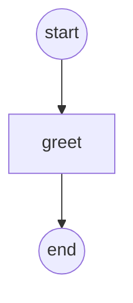

# hello: the smallest offering

A seller offering, `acme/hello@0.1.0`: give it `{"name": "Ada"}`, get `{"greeting": "Hi Ada"}`
back, for a flat 0.01 USD per job. No files, no progress, no network: the whole shape of an
offering with nothing in the way, and five minutes from this directory to a job someone paid
for.

**A live copy runs as `demo/hello` on [app.kontra.run](https://app.kontra.run)**: hire it
before you sell your own.

| File | Owner of |
|---|---|
| `offering.yaml` | name, version, limits, display text: declarative, no code names |
| `models.py` | `HelloInput` (`name`, 1 to 100 characters) and `HelloOutput` (`greeting`); the published contract is derived from them |
| `workflows.py` | `HelloFlow`: runs the one activity, with a timeout and retries; vanilla Temporal (`from temporalio import workflow`), no `kontra` import |
| `activities.py` | `greet`, the work itself; a plain `temporalio` activity |
| `quote.py` | the price: 0.01 USD whatever the name, and a refusal for a blank one |
| `worker.py` | `serve(HelloFlow, ...)`: the binding of workflow and quote to the offering, and all worker tuning; the one file that imports `kontra`, and it finds `greet` itself |
| `input.json` | a sample input, for `kontra quote` and `kontra hire` |
| `contract.yaml` | the derived contract document, kept as a golden file (seam ③) |

A job goes like this. The buyer's client checks the input against the contract and encrypts
it to you and to the buyer; the gate relays it to your `quote`, which answers 0.01 USD; the
buyer accepts, the gate locks the cent in escrow and starts `HelloFlow` on your worker as
`job-<job id>`; the greeting goes back encrypted to the buyer, who accepts it (or lets the
review window close), and the cent is yours, less the platform fee. Kontra only ever holds
ciphertext.

## 1. Sign in

```sh
pip install kontra-sdk
kontra login --email you@example.com   # a sign-in link by mail; the page asks for the code
                                       # this command prints (sign-ups are by invitation)
```

It prints the party you are logged in as, and writes your profile and your encryption key to
`~/.kontra`. Open `offering.yaml` and replace `acme` with your handle (`name: <handle>/hello`):
`acme` is the examples' party, and you can only publish under your own.

## 2. Publish

```sh
cd examples/hello     # in a checkout of this repository, or a copy of this directory
kontra publish        # your login, never an API key (past its first hour it asks you to confirm it's you); prints the contract hash and the endpoint
```

`kontra publish` imports `worker.py`, derives the contract from `models.py` and
`offering.yaml` (the document in `contract.yaml`, sealed with your key instead of the example
one) and puts it in the catalog. A published version is fixed: change a type in `models.py` or
anything in `offering.yaml`, and bump `version` before publishing again.

## 3. Serve

```sh
kontra serve          # on the machine that does the work; Ctrl-C stops it gracefully
```

`kontra serve` runs the worker that `serve(HelloFlow, ...)` in `worker.py` builds, with your profile: an ordinary
Temporal worker on your own namespace. Kontra never runs your code; while nothing serves, a
quote finds nobody to answer it. On a server that does not hold your login, use an API key
(`kontra keys create --label hello`, then `KONTRA_API_KEY`) and your key file (`~/.kontra/key`,
into `KONTRA_HOME`): a key serves and hires, and never publishes.

## 4. Hire it

**From the console.** Sign in at [app.kontra.run](https://app.kontra.run) with the same
address, open your offering in the catalog (or `demo/hello`), type a name into the form drawn
from the contract and request a quote: it says $0.01. Accepting it locks the cent and starts the
job. The delivery is decrypted in your browser tab with your key file (`~/.kontra/key`), which
you import there; then accept it, or let the review window close.

**From the shell**, with some balance (`kontra balance`, `kontra topup 5`):

```sh
kontra quote demo/hello -f input.json            # demo/hello@0.1.0: 0.01 USD
kontra hire demo/hello -f input.json --max-price 0.01 --wait --accept
```

`--wait` prints the delivery, `{"greeting": "Hi Ada"}`. Your own copy is the same commands with
`<handle>/hello`. A name of only spaces gets a rejected quote ("the name is blank"), and an
empty or 101-character one never leaves your machine: the contract says 1 to 100 characters.

**From a program**, with an API key (`kontra keys create --label hello-buyer`) in
`KONTRA_API_KEY` and your key file in `KONTRA_HOME`, to read the delivery:

```python
import asyncio

from kontra.hire import Kontra


async def main() -> None:
    async with Kontra() as k:  # KONTRA_API_KEY, else your login in ~/.kontra
        job = await k.hire("demo/hello", max_price="0.01", name="Ada")
        result = await job.result()  # decrypted with your key, checked against the contract
        print(result.greeting)  # Hi Ada
        await job.accept()  # or job.reject("why"); silence accepts when the window ends


asyncio.run(main())
```

## Without an invitation

`kontra dev` runs a local Kontra in Docker, with play money, and logs you in to it. Log in as
`acme` and this directory runs unchanged: on a dev profile, `kontra serve` publishes the
offering itself.

```sh
kontra dev up --handle acme      # KONTRA_HOME=~/.kontra-dev keeps it apart from a real login
kontra serve                     # from this directory; then, in another terminal:
kontra hire acme/hello -f input.json --max-price 0.01 --wait --accept
```

## Its graph

`kontra graph --mermaid`, from this directory, draws the workflow from mock runs: Temporal's
test server runs it eight times, every activity answered with a value of the type it
declares, so nothing runs for real. `tests/graph/test_cli.py` checks this copy against the
command:



## Tested

`tests/examples/test_hello.py` runs this directory's `worker.py` as `acme` against
`kontra.testing`'s marketplace and a Temporal dev server, no containers: the quote is 0.01 USD,
the hire delivers `Hi <name>`, accepting releases the cent, and a blank name is refused before
anything is locked.

`contract.yaml` is the derived contract, a golden file (see `../enrich/README.md`).
