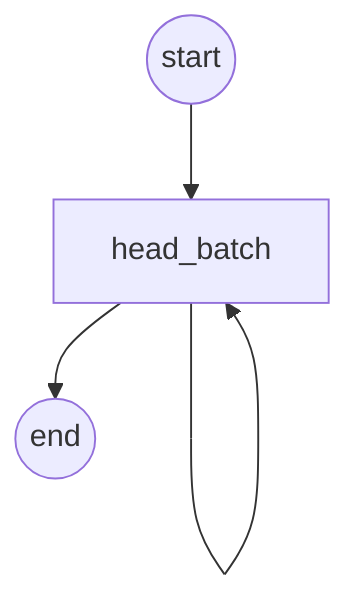

# legacy-actor: an old kontra actor as an offering

`kontra-actors/python/probe` was an Actor with two Methods (`fetch`, `head`), run by Sessions over
Batches of units, scheduled on fleets. This directory is its `head` Method as a v2 offering, to
show what each old concept becomes. The other frozen actors can follow the same path when someone
needs them.

| v1 (actor) | v2 (offering) |
|---|---|
| `@actor.method(takes=Target, emits=Head)` | the workflow signature `ProbeInput -> ProbeOutput` (`models.py`); the contract is derived from it |
| a Batch of units | a list in the input |
| `dataset.push(record)` | a list in the output, or an `Artifact` when it is large |
| `@actor.load` | module-level state in `activities.py`, for what every job on the worker shares (this probe needs none: one HTTP client per batch) |
| a unit that fails | that target's `error` in its `Head`; a target never fails the job |
| `global_state` counters | gone: accounting, not output; a workflow can count for itself |
| Session checkpoints, resume | Temporal's history and retries |
| progress reports | `activity.heartbeat({"percent", "message"})`, for the whole job, forwarded to the buyer |
| `actor.json` targets (container / machine sizes) | the seller's own hardware; tuning is `serve(ProbeFlow, ...)` kwargs in `worker.py` |
| fleets | each batch probes 16 targets at once, and a worker runs `max_concurrent_activities` batches; run more `kontra serve` processes for more, and `max_task_queue_activities_per_second` caps them together |
| datasets, reports | not core in v2; a buyer gets the output, an Artifact for files |
| pricing: none | `quote.py`: a fixed price per job, from the input |

A target is a `url` or a `host` (probed as `http://<host>`), exactly one of the two. The JSON
Schema subset nexgen accepts cannot say "exactly one of", so `models.py` says it and the
worker's handler checks the model: a target with neither or both gets a rejected quote.

**The targets are the buyer's.** Each one has an overall deadline, redirects are followed with
HEAD (no body is ever read), and whatever a target does becomes the `error` of its `Head`. The
old body's blocking `urllib` could not keep those promises (see `activities.py`), so the port
uses httpx's async client instead.

Targets are probed from your machine, inside your network, and a `Head` tells the buyer the
status and `Server` header of whatever answered, so a target may only reach the public
internet. Its host is resolved first and every address it resolves to must be public: not
loopback, private (10/8, 172.16/12, 192.168/16, fc00::/7), link-local (169.254.169.254, the cloud
metadata service, is one), carrier-grade NAT (100.64/10), multicast or unspecified, and an IPv6
address carrying an IPv4 one (`::ffff:127.0.0.1`) is judged by that IPv4 address. The request
then goes to the address that was checked, so a DNS answer that changes in between (rebinding)
cannot redirect it, and each redirect is checked the same way. A target that fails the check
gets the error `ForbiddenAddress`.

To let buyers probe a private network on purpose, set `PROBE_ALLOWED_PRIVATE_NETWORKS` to it
before starting the worker, comma-separated: `PROBE_ALLOWED_PRIVATE_NETWORKS=10.20.0.0/16`. It
is unset by default; the tests set it to `127.0.0.1/32` to reach their own sites. Allow only
what you mean buyers to reach.

Run it like any offering:

```sh
kontra serve        # from this directory, with a profile from `kontra login` or `kontra dev`
```

`contract.yaml` is the derived contract, a golden file (see `../enrich/README.md`).

## Its graph

Under a dev profile, `kontra serve` draws the workflow for `kontra dev`'s graph page from mock
runs: Temporal's test server runs it eight times, every activity answered with a value of the
type it declares, so nothing runs for real. `tests/graph/test_cli.py` checks this copy against
those runs:



`head_batch` is a loop over the targets, 100 at a time: one node with an edge to itself.
