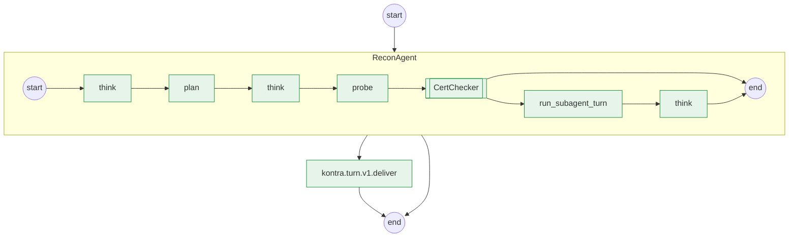

# recon-harness: an agent, sold as one typed handler

A seller offering, `acme/recon-harness@0.1.0`: give it `{"domains": ["example.com",
"example.org"]}`, get back a `SweepReport` (`domains`, `targets`, `expired`, `weak`, `posted`,
`confirmed`, `summary`), for a cent per domain. The work is done by an agent written with
Temporal's [agent harness](https://github.com/temporal-community/temporal-agent-harness):
`ReconAgent` plans, probes, hands the certificates to a subagent of its own (`CertChecker`),
and writes a summary, publishing every step as the harness's events.

**An agent is a workflow whose entry is one typed handler.** `ReconAgent.sweep` takes a
`SweepRequest` and returns a `SweepReport`, and that signature is the contract, derived from
the two pydantic models like any workflow's. The word "agent" appears nowhere in Kontra's
surface: `serve()` takes a workflow class or a handler, the catalog shows a contract and a
stream, and the buyer hires it like any offering.

| File | Owner of |
|---|---|
| `offering.yaml` | name, version, limits, display text, and `streams: [turn_events]`: the agent's events reach the buyer |
| `models.py` | `SweepRequest` and `SweepReport`, the handler's types (both `extra="forbid"`, every output field required), and the tools' and the model's own types |
| `workflows.py` | `ReconAgent` (`@agent.defn`, `@agent.init`, `@agent.accepts sweep`, an `AgentWorkflowRunner` on a `WorkflowStream`) and its subagent `CertChecker`; vanilla Temporal and the harness, no `kontra` import |
| `activities.py` | the tools (`plan`, `probe`, `fetch_cert`, `post_findings`; `confirm`, a callback tool) and the model, `think`, an activity |
| `quote.py` | the price: 0.01 USD a domain, and a refusal for a sweep that would need a person |
| `worker.py` | `serve(ReconAgent.sweep, workflows=[CertChecker], plugins=[AgentHarnessPlugin(tools=TOOLS)])`; the one file that imports `kontra` |
| `input.json` | a sample input, for `kontra quote` and `kontra hire` |
| `contract.yaml` | the derived contract document, kept as a golden file (seam ③) |

## One hire is one turn

An agent workflow's `run` returns nothing (it serves messages until it is closed), so it
cannot be the job itself. The job is Kontra's wrapper workflow, `kontra.turn.v1`, started as
`job-<id>` like any job: it starts `ReconAgent` as its child, sends the buyer's input as one
message to `sweep`, reads the agent's `turn_events` until the handler's reply, closes the
agent, and delivers the reply, encrypted to the buyer. Everything the agent publishes on
`turn_events` is mirrored onto the job's own stream, which the gate relays to the buyer:

```python
import asyncio

from kontra.hire import Kontra


async def main() -> None:
    async with Kontra() as k:
        job = await k.hire(
            "acme/recon-harness", max_price="0.02", domains=["a.example", "b.example"]
        )
        async for event in job.stream("turn_events", type=dict):  # until the job closes
            print(event["event"]["type"])  # turn_started, tool_requested, tool_end, ...
        report = await job.result()
        print(report.summary)


asyncio.run(main())
```

A turn of a hire has no one on the other side to approve a tool call or answer a callback:
`post_findings` (not inherently safe, so the harness asks a person first) and `confirm` (a
callback tool) are what `want_approval` and `want_callback` ask for, and `quote.py` refuses
both before anything is locked. Multi-turn sessions, with the buyer approving, are a later
Kontra feature (kontra-sdk#60); the [dev console](#what-the-dev-console-shows) drives both for
an agent run on its own.

## Two plugins, one converter, one codec

`AgentHarnessPlugin` registers the tools' activities and the subagent activity, and puts the
harness's pydantic payload converter on the worker's client. Kontra's codec is a payload codec,
not a converter: Temporal runs the converter first and the codec on its output, so the two
stack, and every payload of the job -- the message, the tools' arguments and results, the
events -- is encrypted under the harness's converter. `serve()` puts your plugins on the
client ahead of Kontra's, which comes last (`docs/decisions.md` I29).

The harness is this project's dependency, not kontra-sdk's, and it is pre-1.0: pin it exactly.

```sh
pip install kontra-sdk temporal-agent-harness==0.6.0
```

## The model is the worker's

`think` (`activities.py`) is the model: one activity call per step, whose words the agent
publishes as the harness's model events and whose last answer is the report's `summary`. The
steps themselves are the agent's code. Which model answers is the worker's environment, never
the workflow's, as in `../chef-agents`:

- no `LLM_BASE_URL`: a scripted model, with no endpoint and no key -- what the tests run;
- `LLM_BASE_URL` set: any OpenAI-compatible server (Ollama at `http://localhost:11434/v1`,
  vLLM, OpenRouter, Mistral), for the model `LLM_MODEL` names (default `qwen2.5`), with
  `LLM_API_KEY` if it needs one. It needs `pip install openai`.

The prompt carries what the turn learnt as counts, never the buyer's domains. Pointing the
worker at a hosted model is still a fact for the buyer: set `uses_hosted_model: true` in
`offering.yaml` (and bump `version`: it is part of the contract). A model that chooses the
tools itself is the harness's own integrations' (OpenAI Agents, Gemini), which publish these
events from the model's stream: a change of `workflows.py`, not of anything Kontra sees.

## Run it

`kontra dev` runs a local Kontra with no containers and play money and logs you in to it, as
`acme`; this directory then runs unchanged, and `kontra serve` publishes the offering itself.

```sh
kontra dev up --handle acme --ui     # KONTRA_HOME=~/.kontra-dev keeps it apart from a real login
kontra serve                         # from this directory; then, in another terminal:
kontra quote acme/recon-harness -f input.json          # 0.02 USD: two domains
kontra hire acme/recon-harness -f input.json --max-price 0.02 --wait --accept
```

`kontra job <job id> --stream turn_events` prints the agent's events as JSON lines. To sell it
for real, sign in (`kontra login`), replace `acme` in `offering.yaml` with your handle, then
`kontra publish` and `kontra serve`, as in `../hello/README.md`.

## What the dev console shows

The graph page of a hired job (`kontra dev up --ui`, then open the job's workflow) draws the
turn's root, `kontra.turn.v1`, with the agent child nested inside it: the agent's tool
activities, its model calls and its subagent are nodes of their own. Beside it, the **session
pane** renders the agent's turn from its events: the turn, each model call and its words, each
tool call and its result (linked to the node that ran it), the handoff to `CertChecker` with
the subagent's own rows under it, and the reply. A hired turn's pane is read-only. An agent
started on its own, as `ReconAgent` with `want_approval` and `want_callback` in its message,
waits on the approval and the callback, and the pane offers Allow/Deny and a field for the
callback's answer (`docs/sellers.md`, "The agent session pane").

## Its graph

An agent's handler has no static graph (there is no workflow to explore: one hire is one turn),
so this is the graph of a hired run, `kontra.graph.mermaid` of the job's root with its agent
child drawn nested. `tests/examples/test_recon_harness.py` checks this copy against a fresh run:



## Tested

`tests/examples/test_recon_harness.py` runs this directory's `worker.py` as `acme` against
`kontra.testing`'s marketplace (the dev gate) and a Temporal dev server, no containers and no
LLM: the quote is a cent a domain, the hire delivers the typed `SweepReport`, the agent's events
arrive on `job.stream("turn_events")` with the reply among them, accepting releases the escrow,
the dev console's session pane has the turn's rows, and a sweep that asks for a person is
refused at the quote. It also runs `think` against an OpenAI-compatible stand-in, and holds
`contract.yaml` to the harness's own schema of `ReconAgent.sweep`: no difference at all
(`docs/decisions.md` I33). `tests/cli/test_session_lifecycle.py` drives the session pane with
this agent, approvals and callbacks included.

`contract.yaml` is the derived contract, a golden file (see `../enrich/README.md`).
