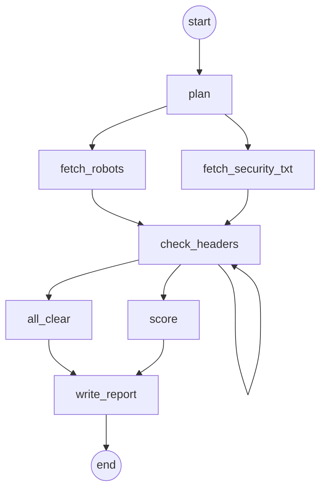

# sweep: a fan-out, one activity per item, and a branch

A seller offering, `acme/sweep@0.1.0`: give it up to 200 URLs, get back which security headers
each page misses, graded A to F, with a value to start from for each, and what each site's
`robots.txt` and `security.txt` say. The report is an encrypted JSON `Artifact`; a small
summary comes back inline. 0.002 USD per URL, 0.01 USD at least.

It is also the example of three shapes a workflow takes besides a straight line, and of the
graph `kontra serve` draws of them (below): two different activities at once (a fan-out),
one activity per item with a bound on how many are open (an `asyncio.Semaphore`, plain
Temporal), and an `if` on what the activities found.

| File | Owner of |
|---|---|
| `offering.yaml` | name, version, limits, display text: declarative, no code names |
| `models.py` | `SweepInput` (`urls`) and `SweepOutput` (`report`, `summary`), from which the contract is derived; and what the activities hand each other |
| `workflows.py` | `SweepFlow`: the five steps below, and `tally`, which folds the checks; vanilla Temporal (`from temporalio import workflow`), no `kontra` import |
| `activities.py` | the work: normalising the input, fetching each site's two files, checking one URL's headers, the report; plain `temporalio` activities |
| `quote.py` | the price, from the number of URLs |
| `worker.py` | `serve(SweepFlow, ...)`: the binding of workflow and quote to the offering, and all worker tuning; the one file that imports `kontra` |
| `contract.yaml` | the derived contract document, kept as a golden file (seam ③) |

```sh
kontra serve                                   # sell it (or: python worker.py)
echo '{"urls": ["https://example.com/", "https://example.org/login"]}' > in.json
kontra quote acme/sweep -f in.json             # price it: 0.01 USD
kontra hire acme/sweep -f in.json --max-price 0.01 --wait --accept
```

Change `acme` to your own handle before publishing. With `kontra dev` (no invitation needed),
`kontra dev up --handle acme`, then `kontra serve` from this directory, runs it unchanged.

## What a job does

1. **`plan`**: each URL once, as it is fetched (scheme and host lowercased, a default port,
   credentials and the fragment left out), and the sites they are on (`scheme://host:port`).
2. **A fan-out**: `fetch_robots` and `fetch_security_txt` at once, each over every site, 16
   sites at a time. `robots.txt`'s `Disallow:` paths, for any user agent, are where a site asks
   crawlers not to look, which is worth a look; `/.well-known/security.txt` (RFC 9116) says
   who to tell about a vulnerability.
3. **One activity per URL**: `check_headers` once per URL, at most 50 open at a time (an
   `asyncio.Semaphore` in the workflow), each retried on its own; then `tally` folds the
   results: a page that sends every header leaves only a count, the others their URL and
   what they miss. Each check is an activity of the job's own workflow, so its history grows
   with the URLs: about six events per URL, and the URL in each direction, which for 200 URLs
   is at most about 1,200 events and 1 MB, far inside Temporal's limits on one history
   (51,200 events, 50 MB). A job of tens of thousands of items would not fit: it would split
   them across child workflows, or continue as new.
4. **A branch** on what that found: `score` when some page misses a header or did not answer
   (each page that misses one graded, worst first: B misses one header, C two, D three, F
   four or more; and the pages that did not answer listed), else `all_clear` (every page A).
5. **`write_report`**: the report, as an `Artifact`.

The headers: `Strict-Transport-Security` with a `max-age` above 0 (on HTTPS only: a browser
ignores it over plain HTTP), `Content-Security-Policy`, `X-Content-Type-Options: nosniff`,
`X-Frame-Options` (`DENY` or `SAMEORIGIN`, or a policy with `frame-ancestors`, which does
its job), and a `Referrer-Policy` other than `unsafe-url`. A page is the final response,
after redirects; its body is never read.

## Its graph

Under a dev profile, `kontra serve` draws the workflow for `kontra dev`'s graph page from mock
runs: Temporal's test server runs it eight times, every activity answered with a value of the
type it declares, so nothing is fetched and nothing is paid. `tests/graph/test_cli.py` checks
this copy against those runs:



The fan-out is one parallel group: the two fetches share their predecessor and both lead to
`check_headers`, which waits for them. `check_headers` is one node however many URLs it
checks: the checks one workflow task starts are one parallel group, and the edge to itself is
the third run's, whose `plan` drew 201 URLs: 50 start at once, and each that completes lets
the next one start, in the workflow task its result wakes. And both branches are there
because the runs drew both answers: the first run's check finds nothing wrong (`all_clear`);
the second's carries an `error`, so its page counts as unreachable, and the run takes
`score`.

## The URLs are the buyer's

Each URL, and each site's file, is fetched with an overall deadline (30 s), redirects are
followed without reading their bodies, a file is read up to 64 kB as sent (never inflated),
and a page's body not at all. Whatever a URL does (refuse, hang, stream forever, redirect in
circles, answer garbage, fail to parse) becomes its row's `error` instead of failing the job.

They are fetched from your machine, inside your network, so a URL may only reach the public
internet. Its host is resolved first and every address it resolves to must be public: not
loopback, private (10/8, 172.16/12, 192.168/16, fc00::/7), link-local (169.254.169.254, the
cloud metadata service, is one), carrier-grade NAT (100.64/10), multicast or unspecified,
and an IPv6 address carrying an IPv4 one (`::ffff:127.0.0.1`) is judged by that IPv4
address. The request then goes to the address that was checked, so a DNS answer that changes
in between (rebinding) cannot redirect it, and each redirect is checked the same way. A URL
that fails the check gets the error `ForbiddenAddress`.

To let buyers sweep a private network on purpose (an intranet you sell audits of), set
`SWEEP_ALLOWED_PRIVATE_NETWORKS` to it before starting the worker, comma-separated:
`SWEEP_ALLOWED_PRIVATE_NETWORKS=10.20.0.0/16`. It is unset by default; the tests set it to
`127.0.0.1/32` to reach their own sites. Allow only what you mean buyers to reach.

## Limits

Every value crosses Temporal as one payload, 2 MB at most: the URLs come back from `plan` in
one, the flagged ones go to `score` in one, and every site's files into the report. So a
job is at most 200 URLs of at most 2,048 characters, written as RFC 3986 writes a URL (ASCII:
anything else percent-encoded, `%C3%BC` for `ü`), and each site keeps its first 10
`Disallow:` paths and 5 contacts, each cut at 100 bytes as JSON writes it (a site's files are
whatever it sends: a control character takes six bytes there, an emoji four): the largest
payload stays under 1.7 MB (`tests/examples/test_sweep_limits.py`). That limit is a
Temporal's without Kontra's codec, which this code also runs on; under `kontra serve`, the
codec carries a payload over 256 KiB in the claim-check bucket instead. For more, split the
list across jobs, or have `check_headers` write its rows to an `Artifact` and keep only
counts.

## Tested

`tests/examples/test_sweep.py` runs this directory's `worker.py` as `acme` against
`kontra.testing`'s marketplace and a Temporal dev server, no containers, over local sites: a
hire whose pages miss headers (scored) and one where none does (all clear), the report
downloaded and checked, the job's own history read back into its path through the graph
above (its checks one parallel group: fewer than 50 URLs start at once), and the price paid
on accept. `tests/examples/test_ssrf.py` and `test_deadlines.py` hold the activities to
the two paragraphs above.

`contract.yaml` is the derived contract, a golden file (see `../enrich/README.md`).
